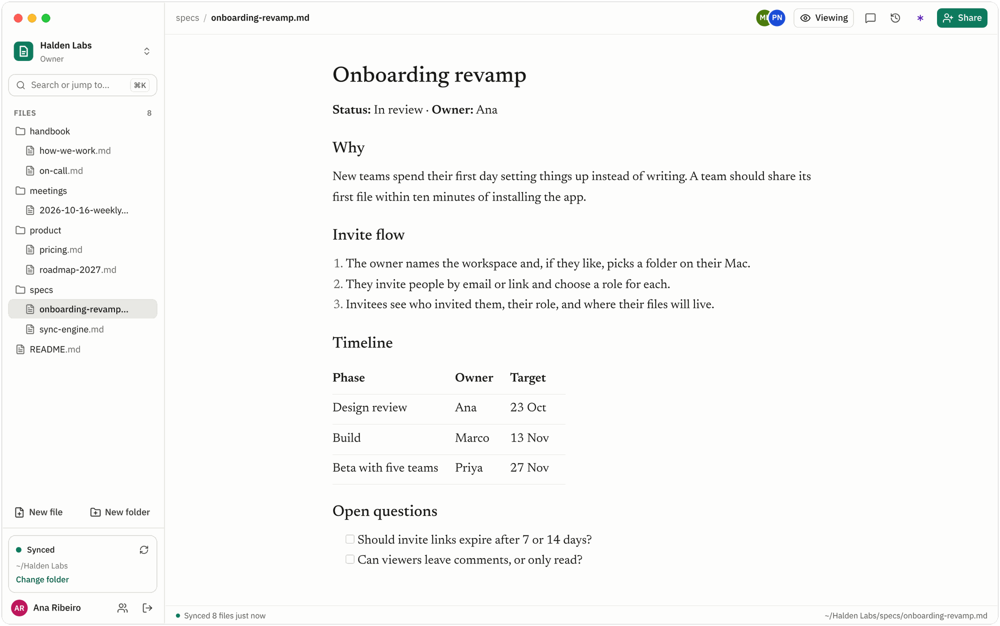
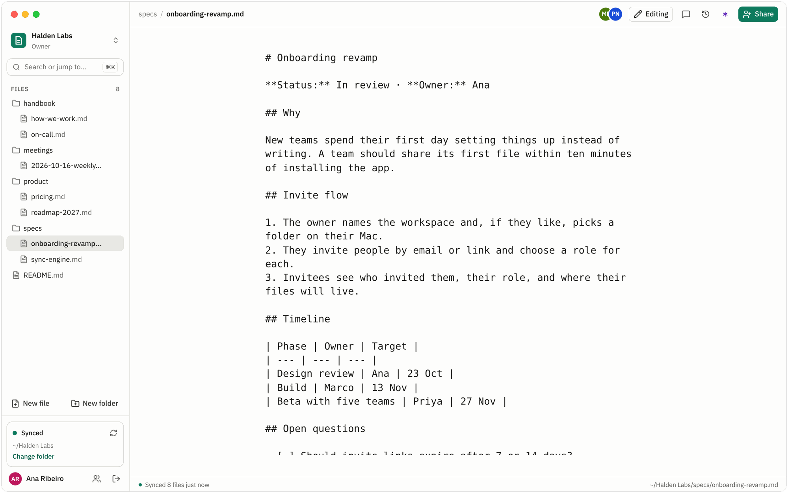
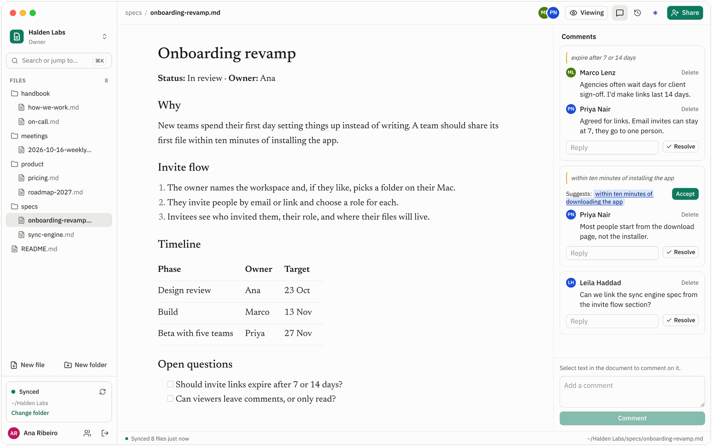
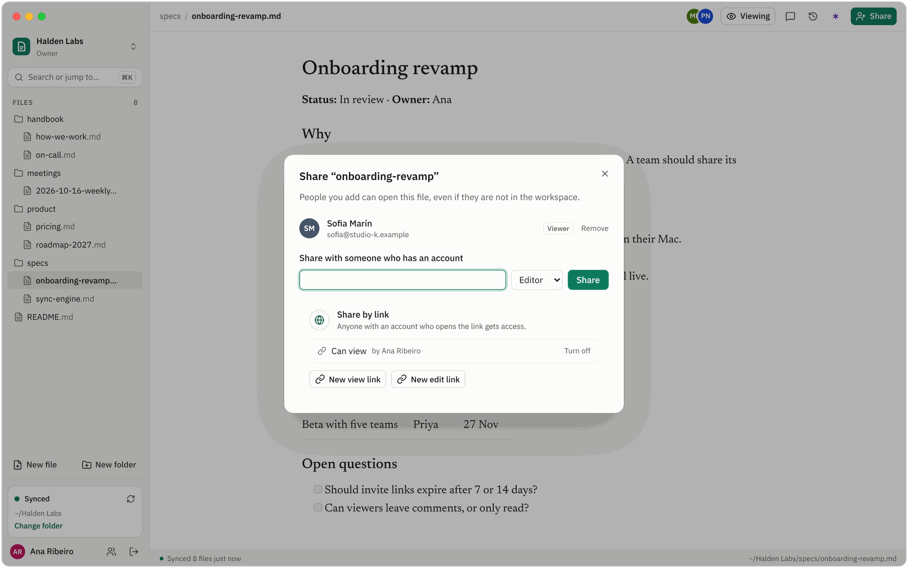
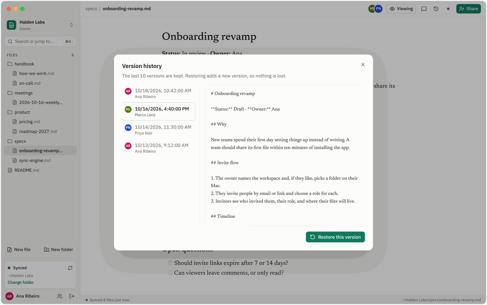
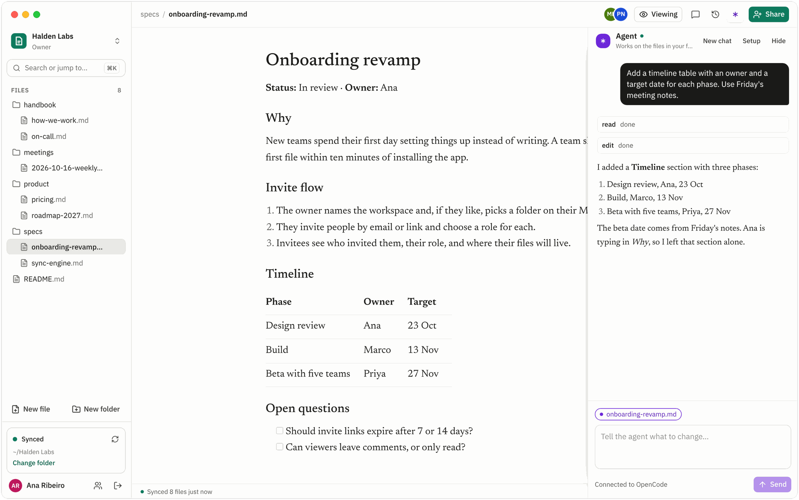
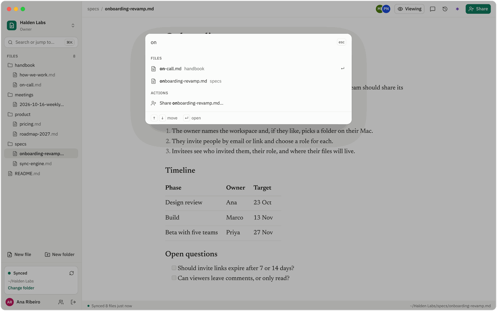
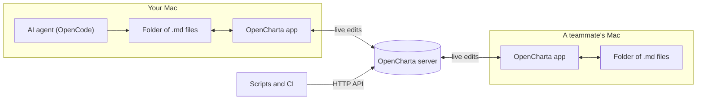
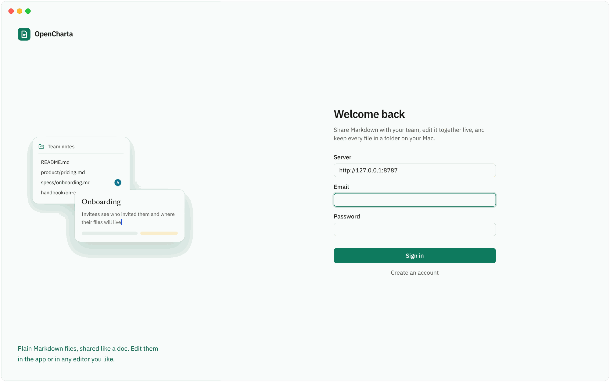

<div align="center">


# OpenCharta

### Google Docs for Markdown.

Share Markdown with your team, edit it together live,<br>
and keep every document as a plain `.md` file in a real folder on your Mac.

[](https://github.com/gosantos/opencharta/actions/workflows/check.yml)
[](LICENSE)


[**Get started**](#get-started) · [Features](#features) · [How it works](#how-it-works) · [Roadmap](#roadmap) · [Developing](docs/development.md)

<br>



</div>

<br>

## Why OpenCharta

Google Docs makes it easy to share a document and write it together, but your words end up in Google's format. Markdown works with every editor, script, git repo and AI tool, but there is no easy way to share it with a team, control who can change what, or edit a file at the same time as someone else.

OpenCharta gives you both. Invite people, give each a role, and write together, live. Underneath, every document is still a plain Markdown file that you can open, script, commit and keep, with or without OpenCharta.

| | Google Docs | Markdown in a git repo | **OpenCharta** |
| --- | :---: | :---: | :---: |
| Documents are plain `.md` files you own | — | ✓ | ✓ |
| Edit together, live | ✓ | — | ✓ |
| Share one file or folder, with a role | ✓ | — | ✓ |
| Comments and suggested edits | ✓ | Pull requests | ✓ |
| Works with any editor, script or AI tool | — | ✓ | ✓ |

## Features

### Edit together, live

Open a file and you see who else is in it. Everyone types into the same document at the same time, and edits merge instead of overwriting each other. It's Markdown the whole time: what you type is exactly what lands in the file.



### Comment, suggest, accept

Select a passage to start a thread about it, or comment on the whole file, then reply and resolve as you go. Anyone who can read a file can comment. Instead of describing a change, propose the replacement: an editor accepts it in one click and it lands as a live edit that merges with whoever is typing. Comments live next to the file, never inside it, so your Markdown stays clean.



### Share it like a doc

Everyone in a workspace has a role: **owner**, **admin**, **editor** or **viewer**. Viewers read, editors change files, and admins and owners manage people. Need to bring in a client or a freelancer? Share a single file or folder with them, as an editor or a viewer, without giving them the rest of the workspace. Or create a share link: the server keeps only a hash of it, and you can turn it off at any time.



### Keep it as files

Each Mac can mirror the workspace to an ordinary folder of `.md` files:

```text
~/Halden Labs
├── README.md
├── handbook/
│   ├── how-we-work.md
│   └── on-call.md
├── product/
│   ├── pricing.md
│   └── roadmap-2027.md
└── specs/
    ├── onboarding-revamp.md
    └── sync-engine.md
```

Edit those files in VS Code, Vim, Obsidian, a script or a git repo, and the changes reach your team. Renames are matched by content, so moving a file in Finder moves it for everyone. If an edit in someone's folder races a live edit, both versions are kept. Nothing is ever overwritten silently.

### Every version, one click away

OpenCharta keeps the last 10 versions of each file, with who made each one. Open any version, read it as Markdown, and restore it. Restoring saves a new version, so you can always go back again.



### An agent that works on real files

The agent panel connects to [OpenCode](https://opencode.ai) running on your Mac. Ask for a change in plain words: the document you have open is attached to your message, so "make this shorter" just works. The agent edits the actual files in your synced folder, and changes to an open document arrive as a live edit, so they merge with what people are typing. It shows its tool calls as it works, can be stopped mid-turn, and asks before doing anything that needs permission.



### Jump anywhere with ⌘K

Open any file by typing part of its name, or run an action such as new file, share, history or sync, without leaving the keyboard.



### An HTTP API for everything

Everything the app does is also available over HTTP, so scripts and CI jobs can read and write the same files your team edits.

```sh
# Sign in and keep the token
TOKEN=$(curl -s -X POST http://127.0.0.1:8787/auth/login \
  -H 'content-type: application/json' \
  -d '{"email":"you@example.com","password":"your-password"}' | jq -r .token)

# List your workspaces, then the files in one of them
curl -s http://127.0.0.1:8787/workspaces -H "authorization: Bearer $TOKEN"
curl -s "http://127.0.0.1:8787/workspaces/$WORKSPACE_ID/nodes" -H "authorization: Bearer $TOKEN"
```

To change a file, `PUT` its new content to `/workspaces/:workspaceId/nodes/:nodeId/content` with the revision you started from. The edit merges live, like anyone else's.

## How it works



- **The server** keeps the shared copy of every file, the last 10 versions, comments and permissions, in SQLite.
- **Live editing** runs on [Yjs](https://yjs.dev) over a WebSocket, so edits made at the same moment merge instead of conflicting.
- **Each Mac** can mirror the workspace to a plain folder, plus one hidden `.opencharta/index.json` that remembers what was synced. Edits from any editor go up; edits from the team come down.
- **Nothing is lost.** When a folder edit and a live edit change the same file at once, OpenCharta keeps both.

## Principles

1. **Plain Markdown is the source of truth.** Your files are always complete and usable without OpenCharta.
2. **Sharing should feel like Google Docs.** Invite someone, give them a role, and they're in.
3. **Never lose an edit.** When changes conflict, keep both sides. Never overwrite silently.

## Get started

OpenCharta is in early development and runs from source for now. You need macOS, [Node.js](https://nodejs.org) 24 or later, and [pnpm](https://pnpm.io) 11.

```sh
git clone https://github.com/gosantos/opencharta.git
cd opencharta
pnpm install
pnpm dev
```

This starts the server on `http://127.0.0.1:8787` and opens the Mac app. Create an account and a workspace, then choose a folder to sync.

<div align="center">

</div>

**Working with a team?** Run the server on one machine. Everyone else enters `http://<that-machine>:8787` as the server when they sign in.

**Want the agent?** Start an OpenCode server on your Mac with `opencode serve`. The agent panel finds it automatically.

**Something not working?** [Developing OpenCharta](docs/development.md) covers tests, configuration and troubleshooting.

## Roadmap

**In v1**

- [x] Accounts, workspaces and the four roles
- [x] Share a single file or folder, as editor or viewer, with a person or by link
- [x] Folders and Markdown files
- [x] Live editing in the Mac app
- [x] Folder sync on each Mac, including renames
- [x] The last 10 versions of each file, and restore
- [x] Comment threads on a file or a quoted passage, with replies and resolve
- [x] Suggested edits that an editor accepts into the file as a live change
- [x] An HTTP API for the same operations
- [x] The agent panel

**Not yet**

- [ ] Apps for platforms other than Mac
- [ ] A web editor

## Built with

[Electron](https://www.electronjs.org) · [React](https://react.dev) · [Tailwind CSS](https://tailwindcss.com) · [shadcn/ui](https://ui.shadcn.com) · [CodeMirror](https://codemirror.net) · [Yjs](https://yjs.dev) · [Hono](https://hono.dev) · [SQLite](https://sqlite.org) with [Drizzle](https://orm.drizzle.team)

## Contributing

Issues and pull requests are welcome. Before opening a pull request, run:

```sh
pnpm typecheck
pnpm test
```

CI runs both on every push, plus `pnpm test:ui`, which builds the Mac app and drives it with Playwright. [docs/development.md](docs/development.md) has the full setup.

## License

[MIT](LICENSE) © 2026 Guilherme

<sub>Screenshots show the app with demo data.</sub>
